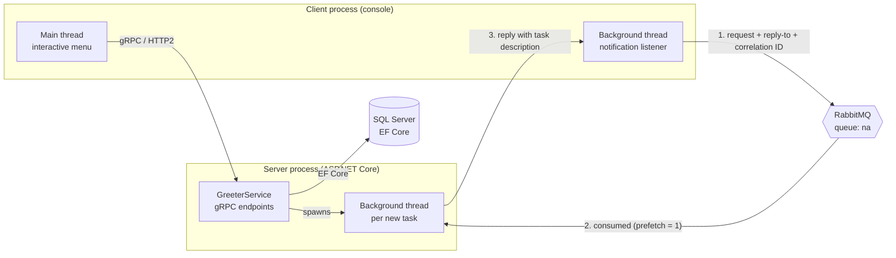
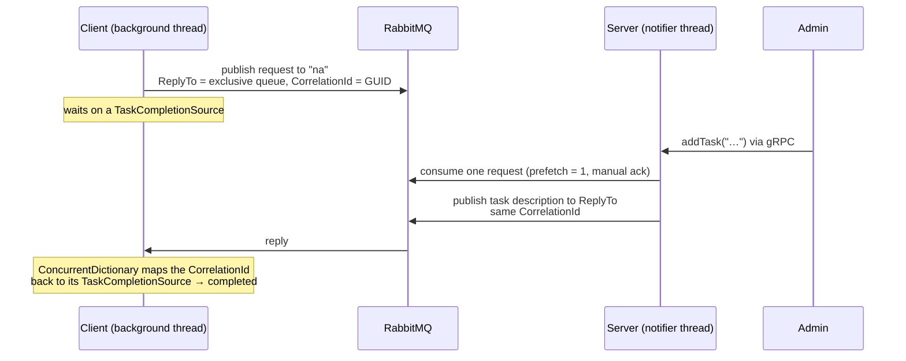
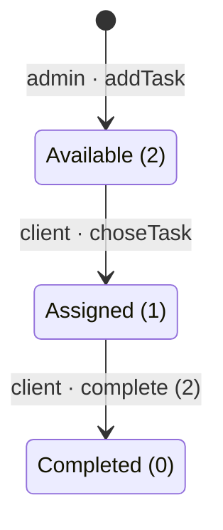

# gRPC Task Dispatch System

A distributed client–server system in **C# / .NET 8**. Clients talk to the server over **gRPC** (HTTP/2 + Protocol Buffers), state is kept in **SQL Server** through **Entity Framework Core**, and new tasks are pushed to subscribed clients asynchronously through **RabbitMQ**. Background threads handle the notifications on both sides, so they never block the interactive gRPC flow.

**Stack:** C# · .NET 8 · ASP.NET Core gRPC · Protocol Buffers · Entity Framework Core · SQL Server · RabbitMQ · multithreading

> Developed by **João Monteiro**, **Ruben Magalhães** and **Gonçalo Monteiro** for the *Distributed Systems* (Sistemas Distribuídos) course at UTAD (Universidade de Trás-os-Montes e Alto Douro), 2023/2024.

## What it does

- An **admin** creates tasks and assigns vehicle numbers to clients.
- **Clients** log in, list the available tasks, pick one (only one at a time), complete it and check their history.
- Clients can **subscribe** to receive a push notification when the admin creates a new task. Each new task is delivered to **one** waiting subscriber.

## Architecture



Client and server are separate processes that share **no memory**. They only communicate through two well-defined channels: synchronous **gRPC** calls for commands, and asynchronous **AMQP** messages for notifications.

### gRPC contract

The contract lives in a single file, [`protos/greet.proto`](protos/greet.proto), which both projects compile. They can never drift apart.

| RPC | Used by | Purpose |
|---|---|---|
| `SayLogin` | all | Authenticate; returns the role (admin/client) and subscription state |
| `SayHello` | all | Menu commands: view/complete tasks, history, subscribe, logout, quit |
| `addTask` | admin | Create a task and trigger a notification to one subscriber |
| `choseTask` | client | List available tasks (`"7"`) or claim a task by ID |

## Concurrency and messaging

**1. Non-blocking task creation (server).** When the admin creates a task, `addTask` saves it and starts a **background thread** that waits on RabbitMQ for a subscriber. The gRPC call returns immediately, even if nobody is subscribed yet.

**2. Background notifications (client).** A subscribed client starts a single **background thread** that listens for new tasks while the main thread keeps handling the menu. The two threads never compete for console input.

**3. RPC over RabbitMQ.** Notifications use the request/reply pattern:



- Each client gets an **exclusive, auto-named reply queue**. A **correlation ID** matches each reply to its pending request.
- Pending requests are stored in a **`ConcurrentDictionary<string, TaskCompletionSource<string>>`**, because replies arrive on RabbitMQ's consumer thread, not on the thread that made the request.
- `BasicQos(prefetchCount: 1)` and **manual acknowledgements** mean each new task is delivered to exactly one waiting subscriber, like a work queue.

## Data model

| Table | Key fields | Notes |
|---|---|---|
| `CLients` | `Client_ID`, `password`, `Admin`, `mota`, `subscriptions` | `subscriptions`: 0 none, 1 service A, 2 other, 3 both |
| `Tasks` | `taskId` (`SA_T1`, `SA_T2`, …), `description`, `state` | |
| `tasks_Clients` | `Task_ID`, `Client_ID` | Which client took which task |



The schema is managed with **EF Core migrations** (`server/GrpcServer/Migrations`), applied automatically when the server starts.

## Repository layout

```
.
├── GrpcTaskSystem.sln         # opens both projects in Visual Studio / Rider
├── protos/greet.proto         # shared gRPC contract
├── server/GrpcServer/         # ASP.NET Core gRPC server
│   ├── Services/              #   gRPC endpoints
│   ├── Broker/                #   RabbitMQ notifier
│   ├── Data/ Models/          #   EF Core context and entities
│   └── Migrations/            #   database schema history
├── client/GrpcClient/         # console client
└── docker-compose.yml         # SQL Server + RabbitMQ for local development
```

## Running it

**Prerequisites:** [.NET 8 SDK](https://dotnet.microsoft.com/download), plus either Docker or (on Windows) SQL Server LocalDB and a local RabbitMQ.

1. **Start the infrastructure**

   ```bash
   docker compose up -d
   ```

   This starts SQL Server on `localhost:1433` and RabbitMQ on `localhost:5672`, with a management UI at http://localhost:15672 (`guest`/`guest`).

2. **Trust the ASP.NET Core development certificate** (one time only; needed for HTTPS/HTTP2):

   ```bash
   dotnet dev-certs https --trust
   ```

3. **Run the server**

   ```bash
   # With Docker's SQL Server. On Windows with LocalDB, skip this line: the default connection string uses LocalDB.
   export ConnectionStrings__DefaultConnection="Server=localhost,1433;Database=SistemasDistribuidosDB;User Id=sa;Password=Dev_Passw0rd!;TrustServerCertificate=True"

   dotnet run --project server/GrpcServer --launch-profile https
   ```

   On first start, the database is created and, in Development, three demo users are seeded: `admin`/`admin`, `alice`/`alice` and `bob`/`bob`.

4. **Run one or more clients**, each in its own terminal:

   ```bash
   dotnet run --project client/GrpcClient
   ```

| Setting | Where | Default |
|---|---|---|
| Server URL | client env `GRPC_SERVER_URL` | `https://localhost:7140` |
| RabbitMQ host | client env `RABBITMQ_HOST` · server `RabbitMQ:HostName` | `localhost` |
| Database | server `ConnectionStrings:DefaultConnection` | SQL Server LocalDB |

### Try the notification flow

1. Log in as `alice`, choose **6** to subscribe, then `5` to log out and log in again. The listener starts at login.
2. In a second terminal, log in as `admin`, choose **1** and type a task description.
3. Alice's terminal shows the notification. She can then choose **7** to list and claim the task, **1** to see it and **2** to complete it.

## Known limitations

This was a course project focused on distributed communication and concurrency. It is not production-ready:

- **Passwords are stored and compared in plain text.** They should be hashed (for example with PBKDF2 or Argon2).
- **There are no session tokens.** After login, the client sends its own ID on every request and the server trusts it. A real system would issue a token (such as a JWT) and read the identity from gRPC metadata.
- **Concurrent task claims are not protected.** Two clients claiming the same task at the same instant could both succeed. An EF Core concurrency token or a conditional `UPDATE` would fix this.
- **The protocol is menu-driven.** Some commands are sent as menu numbers through a generic RPC (`SayHello`). Dedicated RPCs per operation would give a clearer, typed API.
- **Each task is notified to one subscriber.** This is by design (work-queue semantics), but it is not a broadcast.

## Changes made for publication

The original code lived in two separate repositories. For publication it was merged into this single repository. The `.proto` contract is now shared, and duplicated menu strings, dead code and file-encoding issues were cleaned up. Database migration and demo seeding were added on startup, and service addresses were made configurable. A few bugs were also fixed:

- The client started a new notification thread on every menu iteration, and that thread also read from the console, competing with the menu for input.
- `choseTask` checked the wrong task when testing whether a client already had an assigned task, and reported success when the task was already taken.
- `quit` left the client stuck in its menu loop.
